# 📡 API Probe

 

API Probe is a small command-line smoke checker for HTTP endpoints. Keep a list of service URLs in a JSON file and run the same checks before or after a deployment.

## 💡 Why it exists

Manually opening several URLs is repetitive and makes it easy to miss a failed endpoint. A tiny scripted probe gives teams a repeatable first-line health check.

## ✨ Features

- Read named GET checks from a JSON configuration file.
- Measure elapsed request time and record HTTP status.
- Compare actual status with an expected status.
- Print a concise pass/fail summary and meaningful exit code.
- Use urllib from the Python standard library.

## 🧩 Architecture

A JSON config is parsed into endpoint definitions. Each endpoint is requested with a bounded timeout; HTTP errors are recorded as responses rather than hidden exceptions. The first version does not implement authentication or load testing.

~~~text
apiprobe/
|-- README.md
|-- apiprobe.py
|-- checks.example.json
~~~

## ⚙️ Setup

Requires Python 3.9+. Save apiprobe.py and create a JSON config.

## 🚀 Quick start

~~~bash
python apiprobe.py checks.example.json
~~~

Each check should have name, url, and optional expected_status fields. Use --timeout to adjust the request timeout.

## 🧪 Example

A check for https://example.com with expected_status 200 passes when the server responds with HTTP 200 within the configured timeout.

## 🎯 Scope and safety

This is a low-volume smoke checker, not a load-testing tool. Only probe systems you own or are authorized to test. The starter version sends simple GET requests and has no authentication support.

## 🗺️ Roadmap

- [ ] Add configurable headers from environment variables.
- [ ] Add response-body substring assertions.
- [ ] Add JUnit-style output for CI systems.

## 🤝 Contributing

Include a sanitized config and a reproducible response scenario when reporting an issue. Never commit credentials or private endpoint details.

## 📄 License

No license file has been selected yet. Do not assume redistribution or reuse rights until a license is added.
